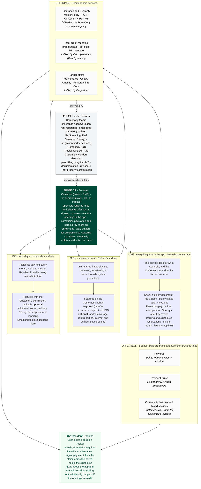

# The Homebody model

> Canonical reference for how this war room organizes work. Drafted 2026-10-15 by Catherine Wong from the Oct 1 slate, the Homebody Quarter Brief ([Entrata-Collab/rxp](https://github.com/Entrata-Collab/rxp)), and the product as shipped. Correct it here; the app reads the same structure from `src/data/areas.json`.

## The one-paragraph version

Homebody is a portfolio of **offerings** for residents. Two parties decide, so no word does double duty: the Customer **sponsors** an offering (puts it on the property's menu, sets it as required or optional, collects through the ledger, sometimes pays Entrata a fee for it and earns a revenue share back when residents enroll) and the Resident **enrolls** in it, or **satisfies** a required line with an alternative. A required line is met one way or another; only how it is met changes. Residents reach the offerings through three surfaces: **Sign** (Entrata's lease flow, where Homebody is a guest), **Pay** (Homebody's own rent experience, which is absorbing the old Resident Portal), and **Live** (everything else the resident does in the app). Pay and Live are separate because Pay is a required moment every month unless autopay is on, while Live is optional: a resident may go a whole lease without submitting a maintenance ticket, reserve the clubhouse, check a policy, or file a claim. The app is the access mechanism, not the value. The value is the offering, and **Fulfill** is where it is delivered: a Homebody fulfillment team, an embedded partner, an integration partner, Homebody R&D, or the Customer's own vendor.

The one sentence to remember: **Sponsor, Resident, and Fulfiller are three different parties.** In core Entrata the buyer is the user and Entrata fulfills by shipping software. In Homebody the Customer sponsors, the Resident enrolls, and someone else delivers. That is why Homebody does not behave like the rest of Entrata; see [the three patterns](#why-homebody-does-not-behave-like-the-rest-of-entrata) and [the vocabulary](#vocabulary-and-where-it-is-borrowed-from).

## The diagram



## The four surfaces

| # | Surface | Whose | What happens here | Surface Area Coordinator | Headline number |
|---|---|---|---|---|---|
| 1 | **Sign** · lease checkout | **Entrata's.** The leasing product owns the flow; Homebody is featured in it on the Customer's behalf. | Signing, renewing, and transferring a lease, plus the move-in checklist. Some offers are **required** by the lease (proof of insurance, a deposit or HBG); some are **optional** (added coverage, rent reporting, internet and utility setup, pet screening). The highest-intent moment Homebody has and the only place "required" exists. Changes here are negotiated with the leasing team, not shipped by Homebody alone. | Zack Melton | Insurance conversion at signing, MTD (needs Jae Lee) |
| 2 | **Pay** · rent day | **Homebody's.** | Residents pay rent every month, web or mobile. The old Resident Portal is being retired into this. A required moment twelve times a year unless autopay is on, which is why it is separate from Live. Optional services are featured with the Customer's permission; email and text nudges land here. Nothing can be offered to a resident who is not here, which is why migration is the first track. | Joe Wilson | Residents logged in, 30d: 225.5K, target 3M MAU |
| 3 | **Live** · everything else in the app | **Homebody's.** | Optional where Pay is required: a resident may go a whole lease without filing a claim, submitting a maintenance ticket, or booking the clubhouse. The service desk for everything Homebody sold (check a policy document, file a claim, policy status after move-out) and the Customer's front door for its own program and services (Rewards, satisfaction surveys after key events, parking and clubhouse reservations, the bulletin board, laundry app links). Residents do not buy most of this; the Customer buys it or provides it. It is what makes the app a daily destination, which is what Pay depends on. | Joe Wilson (Rewards: Britton Pederson) | Rewards revenue, MTD (needs Britton Pederson) |
| 4 | **Fulfill** · who delivers | **Homebody teams and partners.** | Where offerings get delivered, and it varies by offering. Insurance: a Homebody insurance agency handling policies, claims, carriers, and partnerships, with embedded carriers for specific lines. Rent reporting: a small team in Logan from the RentDynamics acquisition, reporting to all three bureaus and handling opt-outs. Partner offers and Rewards redemption: embedded partners. Resident Pulse: Homebody R&D with Entrata core. Linked services: the Customer's vendor. Plus billing integrity on the Customer's ledger, verification (IVS), documentation and support for Customer staff, rev share, and per-property configuration. When fulfillment fails the Customer is exposed, which is why most client heat lives here. | Chris Finken | Open billing incidents: 4 |

Every track in `src/data/tracks.json` has an `area` from this table and a list of `products` from the next one.

## The offerings

"Offering" is the umbrella term for everything the Sponsor puts in front of residents through Homebody. Offerings are cut two ways, and the two axes are independent.

### Type: who consumes, who pays, why the Sponsor turns it on

| Type | Consumes | Pays | Why the Sponsor turns it on | Offerings |
|---|---|---|---|---|
| **Resident-paid service** | Resident | Resident enrolls and pays; the Sponsor sets required or optional, collects on the ledger, may pay Entrata a fee for the offering, and earns a rev share on enrollment | Compliance or risk reduction (insurance), rev share (rent reporting), amenity value. Entrata earns on each. The voluntary-benefits pattern. | Insurance and Guaranty · Rent credit reporting · Partner offers |
| **Sponsor-paid program** | Resident uses it; the Sponsor gets the outcome | Sponsor | Retention, resident behavior, insight. The employer-paid-benefit pattern. | Rewards · Resident Pulse |
| **Sponsor-provided** | Resident | No one; it comes through Entrata | Convenience. The app is the front door to things the Sponsor already provides. | Community features · Linked services |

### Fulfiller: who actually delivers it

| Fulfiller | What it means | Examples |
|---|---|---|
| **Homebody fulfillment team** | A Homebody operations group does the work every day. | Insurance agency; rent reporting team in Logan (from the RentDynamics acquisition) |
| **Embedded partner** | Delivers under Entrata's paper. The resident experiences it as Homebody. | Carriers for specific insurance lines, PetScreening, Red Ventures, Chewy, Rewards redemption partners |
| **Integration partner** | An integration Homebody built to extend product roadmap coverage. | Cobu |
| **Homebody R&D with Entrata core** | Software-fulfilled. The work is placing it in the right Entrata workflow and joining it to the triggering event in the unified data layer. | Resident Pulse |
| **Customer's vendor** | The Customer's own contract and app. Homebody links out. | Laundry app, parking vendor |

Contracts follow the Fulfiller, not the surface. Every contracts cell below is a hypothesis until someone confirms it.

### The portfolio

| Offering | Type | Reached on | Required or optional | Who pays whom | Fulfilled by | Contracts (to confirm) | Owner | Tracks |
|---|---|---|---|---|---|---|---|---|
| **Insurance and Guaranty** | Resident-paid | Sign · Pay · Live | Proof of coverage is a lease condition at most properties: default enrollment in the Master Policy, or satisfied with an HO4 or an outside policy IVS verifies. HBG is required with the deposit as the alternative. Contents and additional lines are elective. Documents, status, and claims live on Live. | Resident pays the premium; the Sponsor collects it on the ledger. Entrata and the Sponsor earn. | Team: Homebody insurance agency, with embedded carriers for specific lines | Customer to Entrata for the program; Entrata's agency to carriers; resident under the master policy or holding their own HO4 | Jae Lee | #2 #3 #5 #6 #7 #8 |
| **Rent credit reporting** | Resident-paid | Sign · Pay | Optional: opt in at signing or on Pay. Some states (Maryland most recently) require the Customer to offer it. | Resident pays a fee or it is bundled; the Customer earns a rev share. | Team: Logan rent reporting team; three bureaus, opt-outs, disputes | Customer to Entrata; resident consent at opt-in | Owner to confirm | none |
| **Partner offers** | Resident-paid | Sign · Pay | Elective; the Sponsor turns it on by property. Internet and energy (Red Ventures) at move-in; Chewy, Amenify, PetScreening on Pay and in outreach. | Resident pays the partner; the partner pays Entrata a referral share. | Embedded partner | Entrata to partner (referral, rev share); resident to partner for the service itself | Owner to confirm | none |
| **Rewards** | Sponsor-paid | Live · Pay | The Sponsor's loyalty program. The Sponsor rewards residents for great behavior and picks the behaviors that earn points. The resident earns; the Sponsor pays. | Sponsor pays Entrata for the SKU. | Embedded partner: Homebody runs the points ledger; redemption partners fulfill the rewards | Customer to Entrata for the SKU; Entrata to redemption partners | Britton Pederson | #4 |
| **Resident Pulse** | Sponsor-paid | Live | Satisfaction surveys after key events (maintenance order completed, move-in, renewal). The resident answers; the Sponsor gets the signal. | Sponsor-side value; pricing to confirm. | Homebody R&D with Entrata core: inject the survey at the right workflow step, join event to results in the unified data layer | Customer to Entrata | Owner to confirm | none |
| **Community features** | Sponsor-provided | Live | Amenity, parking, and clubhouse reservations and the bulletin board, configured by the Sponsor and run by its staff. | No direct Entrata revenue; it is why the resident opens the app between rent payments. | Entrata software plus Customer staff; Cobu as an integration partner | Customer to Entrata (included); Customer to Cobu where used | Owner to confirm | none |
| **Linked services** | Sponsor-provided | Live | The Sponsor's own apps that Homebody links to: laundry machine app, parking vendor. | None through Entrata. | Customer's vendor | Customer to vendor; none with Entrata | Owner to confirm | none |

Resident Pulse is the oddball in the portfolio. The Sponsor is the real consumer (of the signal), and fulfillment is a build rather than an operation. It behaves like pattern-1 software inside a pattern-3 portfolio, which is a reason to manage it with the core product process rather than the war room's fulfillment lens.

### Insurance by line

Insurance is one offering with several lines, and the lines do not share economics or attention. HBG is the proof: it is one line, yet it is the subject of three tracks (#2 renewals, #8 transfers, #6 documentation), a large part of #3 billing, and five of the six burning client threads. No one can say yet whether that share of the room matches its share of revenue. The lines are owned by Josh Tebbs, who runs the Homebody insurance agency. Jae Lee owns the Sign funnel (#5), which is one funnel for two of these lines, not the insurance business.

| Line | Reached on | Path | What it is | Attention today | Revenue | Role beyond revenue |
|---|---|---|---|---|---|---|
| **Master Policy** | Sign · Live | Default enrollment | Default coverage that satisfies the lease's proof-of-insurance condition when the resident brings no policy. ~200K active policies (INC 1497). | #3, #5; Trinity | Josh Tebbs to supply | The volume line. To confirm. |
| **Contents** | Sign · Pay · Live | Elective | Optional personal-property coverage on top of the Master Policy. | #3; Landmark | Josh Tebbs to supply | The attach line. To confirm. |
| **HO4 renters policy** | Sign · Pay · Live | Alternative to Master Policy, Homebody-sold | A full renters policy Homebody sells; at signing it is the alternative to the Master Policy that keeps the premium with Homebody. HO4 vs. Master Policy pricing is an open action item. | #5 | Josh Tebbs to supply | To confirm. |
| **Outside policy, verified by IVS** | Sign · Live | Alternative to Master Policy, outside carrier | The resident's own policy; IVS verifies it against the lease requirement. No premium to Entrata. | #7 | None. $142K in client credits from verification failures (decisions.json: ivs-credits). | Not a revenue line; a liability line. |
| **Homebody Guaranty (HBG)** | Sign · Live | Required, deposit is the alternative | Replaces the required security deposit. Renewals, transfers, documentation, and ledger charges all open. | #2, #3, #6, #8; Priess, Asset, Landmark, Cardinal, Yugo, Meridian | Josh Tebbs to supply, net of claims | Deposit replacement is one reason Customers adopt Homebody at all. Strategic role to confirm. |
| **Deposit Alternative (DA)** | Sign · Live | To confirm | The earlier deposit-replacement product; policies still in the field. HBG renewal rules deliberately do not copy DA auto-renewal. Whether it is still sold, and how it relates to HBG, to confirm. | none | Josh Tebbs to supply | To confirm. |
| **Additional lines** | Pay · Live | Elective | Other coverage offered on Pay where the Sponsor turns it on. Which lines, and which are embedded carriers, to confirm. | none | Josh Tebbs to supply | To confirm. |

### Economics per offering

Every offering and every line carries the same five fields in `areas.json`: revenue (TTM), what Entrata keeps after the Sponsor's rev share and the carrier or partner's cut, distribution (doors sponsored), residents enrolled, and a one-line role beyond revenue. Velocity (enrollments per 100 sponsored doors) follows from the middle two once they exist. All of them are blank today except Master Policy's active-policy count and the IVS credit figure, and each blank names the person who owns the number. The Model tab computes **attention share** for each row from this repo: the tracks that move it plus the live client threads tagged with it, over everything the room is carrying. Revenue share sits next to it, blank. The comparison is the point: a line at 67% of attention needs a revenue number before anyone can say whether that energy is appropriate.

## Vocabulary, and where it is borrowed from

Two parties decide, so no word does double duty. The Customer is still "the Customer" as an Entrata account; **Sponsor** is its role inside Homebody.

| Term | Meaning here | Precedent |
|---|---|---|
| **Sponsor** | The Customer's role in Homebody. Puts an offering on a property's menu, sets it as required or optional, collects through the ledger, sometimes pays Entrata a fee for the offering and earns a revenue share back when residents enroll, and pays outright for programs like Rewards. | Plan sponsor in employer voluntary benefits: offers the menu, pays anywhere from none to all of the premium, collects by payroll deduction. The more the sponsor endorses (names it, brands it, collects it, helps with claims), the more it owns the outcome. That is the IVS credits story. |
| **Enroll / satisfy** | What the Resident does. Enrolls in an offering, or satisfies a required line another way: own HO4 or an outside policy IVS verifies instead of the Master Policy, a deposit instead of HBG. A required line cannot be skipped; only the way it is met changes. | Elect, enroll, and waive-with-proof at open enrollment. Lease signing is open enrollment; renewal and transfer are qualifying events. Unlike benefits, the lease condition itself is not waivable. |
| **Sell-in / sell-through** | Sell-in is winning sponsorship at a property. Sell-through is residents enrolling. | CPG: shipments to the retailer vs. what left the shelf. Managing on sell-in alone is driving by the rear-view mirror. |
| **Distribution** | Share of doors where an offering is sponsored. Replaces "offered." Weight by doors, not property count. | CPG % ACV distribution: stores carrying you, weighted by store size. A SKU is "authorized" when the retailer agrees to sell it. |
| **Attach / enrollment rate** | Residents enrolled over residents eligible at the moment the offer is presented. Attach for required lines at signing; enrollment rate for elective ones. | Embedded insurance: attach rate is the year-one diagnostic and moves more with placement and wording than with price. |
| **Velocity** | Enrollments per 100 sponsored doors. | CPG: units per store per week. Distribution says where you are; velocity says whether you deserve to stay. |
| **Fulfiller** | Who delivers once a resident is enrolled. | Instacart's shopper, DoorDash's Dasher, the carrier behind an embedded policy. |

Why benefits and not marketplaces: Instacart and DoorDash's first party is a merchant reselling its own goods and acting as merchant of record. The PMC is neither. It authorizes, sometimes pays, and collects, which is exactly the plan-sponsor role. The marketplace analogy still holds for fulfillment (someone other than the platform does the work) and for the lesson that the platform gets blamed for the fulfiller's failures.

## Why Homebody does not behave like the rest of Entrata

Entrata delivers value in three patterns. The company is built for the first one.

| Pattern | Who buys or sponsors | User | What is delivered | Fulfillment | Examples |
|---|---|---|---|---|---|
| **1. Software to the Customer** | Customer (owner or PMC) | Customer. Buyer and user are the same people. | Software | None beyond implementation and training. | Core Entrata: leasing, accounting, operations. Contracting, training, support, and roadmap all follow one path. |
| **2. Service to the Customer** | Customer | Customer, mostly. The resident receives a bill. | A service. Software exists mainly to make the service team efficient. | An Entrata operations team does the work every month. | Utilities. Heavy fulfillment, little software. Struggles when run with software metrics and software staffing. |
| **3. Service to the Resident, sponsored by the Customer** | The Customer as Sponsor: puts it on the menu, sets required or optional, collects on the ledger, sometimes pays Entrata a fee and earns a revenue share back on enrollment. | Resident. Enrolls, or meets a required line with an alternative; the app is how they reach it and where they complain about it. | Offerings: resident-paid services, Sponsor-paid programs, Sponsor-provided links. | Varies by offering: a Homebody team, an embedded partner, an integration partner, Homebody R&D, or the Sponsor's own vendor. | Homebody. ResidentVerify is a cousin: the Customer buys screening, but the user asking about status is a prospect. |

What pattern 3 changes for a war room:

- **Sponsor, Resident, and Fulfiller are three different parties.** The Customer sponsors, the Resident enrolls, and a team, a partner, or the Sponsor's vendor delivers. Escalations arrive through the Customer, after the fact, about something a third party did.
- **Contracts follow the Fulfiller.** An embedded partner is on Entrata's paper; an integration partner is on the Customer's; a linked vendor has no relationship with Entrata at all. The same app screen can sit on three different contracts.
- **The app is not the value.** Measuring Homebody by app metrics alone is like measuring an insurance agency by its website traffic. The app's job is access; the service's job is the outcome. Both need numbers.
- **Service failures look like client escalations, not bug reports.** A wrong charge on a ledger, an unverified policy with a loss, a renewal that did not happen: these are fulfillment incidents. They need a service owner, a remediation wave, and a credit, not a sprint ticket.
- **Fulfillment groups are real teams with their own operations.** The insurance agency and the Logan team are not "backend." They are the business. A war room that cannot name their leads and their SLAs is managing the storefront and ignoring the warehouse.
- **"Required" creates liability the software business never had.** When the Customer makes insurance a lease condition and the fulfillment fails, the Customer is exposed. That is why IVS turned into $142k of credits.

## How to read the diagram

1. **The app is the mechanism, not the value.** A resident logs in to reach a service or to complain about one. Measure the service; treat the app as the access rate to it.
2. **Sign is Entrata's surface; Pay and Live are Homebody's.** Placement on Sign is negotiated with the leasing product. Pay is owned outright and is where Resident Portal is being retired. Live is the service desk and the community.
3. **"Required" only exists on Sign.** Lease conditions the Customer sets make the Customer liable when fulfillment fails. IVS and billing integrity are fulfillment tracks, not product bugs.
4. **Type and Fulfiller are separate axes.** Who pays tells you why the Sponsor turns an offering on. Who fulfills tells you where it breaks and who signs the contract. An offering without a named fulfiller is an escalation waiting to happen.
5. **Live is foot traffic for Pay.** Without claims, documents, Rewards, surveys, reservations, and the laundry link, the app is a monthly bill and the optional services go unseen.
6. **Money flows differently per offering.** Insurance: resident pays, Entrata and Customer earn. Rent reporting: resident pays a little, Customer earns a share. Partner offers: resident pays the partner, partner pays Entrata. Rewards and surveys: Customer pays Entrata.
7. **Sell-in comes before sell-through.** Every offering is sponsored per property. Distribution (share of doors sponsored) is the number in front of every attach and enrollment number, and it does not have an owner yet. Velocity, enrollments per 100 sponsored doors, says whether a line deserves its shelf.
8. **The resident can outlive the lease, if the offerings earn it.** The goal is an experience compelling enough that the resident keeps the app, the policies, and the rent reporting history after moving out, because that is the one place Homebody has a direct relationship with the resident that does not route through a Customer. It is not a foregone conclusion: a resident who bought only the insurance the lease required has no reason to stay.

## Metric chain

```
Sponsor turns the offering on at a property      distribution, per offering            (no owner yet)
  → Resident reaches a surface                    lease events; residents logged in, 30d
    → Resident sees the offer                     placement rate, per surface
      → Resident buys or earns                    conversion per surface × offering; Rewards participation
        → Service is fulfilled                    policy issued, claim paid, tradeline posted, points credited   (no metric here yet)
          → Charge posts, Customer gets paid      billing incidents; IVS exceptions; rev share paid
```

The Quarter Brief's two program numbers, Active Resident Rate and Resident Revenue per Door, sit at the "reaches a surface" and "buys" steps. Neither is wired into this app yet. There is no fulfillment metric at all.

## What the model exposes today

- Six of eight tracks are about insurance. Rent reporting, partner offers, Resident Pulse, community features, and linked services have no track.
- Every contracts cell is "to confirm." No one has written down yet who contracts with whom per offering.
- HBG is roughly two-thirds of the room's attention (four tracks, six client threads) and no revenue figure for it, gross or net of claims, exists in the room. The same is true for every other line.
- Pay has one track (migration) and nothing about what is offered once residents are in it. Live has one track (Rewards) and nothing on claims, documents, Resident Pulse, or community features.
- Five headline numbers are blank, and there is no fulfillment metric (claims cycle time, issuance lag, bureau accuracy, opt-out handling). Today's client heat is fulfillment heat, measured only as escalations.

These are either tracks someone claims or scope the room explicitly declines. Both are fine. Silence is not.

## Relationship to other documents

- [Mission Control playbook](https://github.com/Entrata-Collab/operating-playbooks/blob/main/mission-control.md): the operating model this war room runs on.
- [Homebody Quarter Brief (rxp)](https://github.com/Entrata-Collab/rxp): the quarter bets and program metrics. Its "Engine A / Engine C" framing maps to the offerings here (Engine A = Insurance, Rent reporting; Engine C = Partner offers). This document adds the surface distinction (Sign is Entrata's), the Live surface, Fulfill, and the three delivery patterns.
- `docs/strategy.md`: why this war room exists and how it is run.
